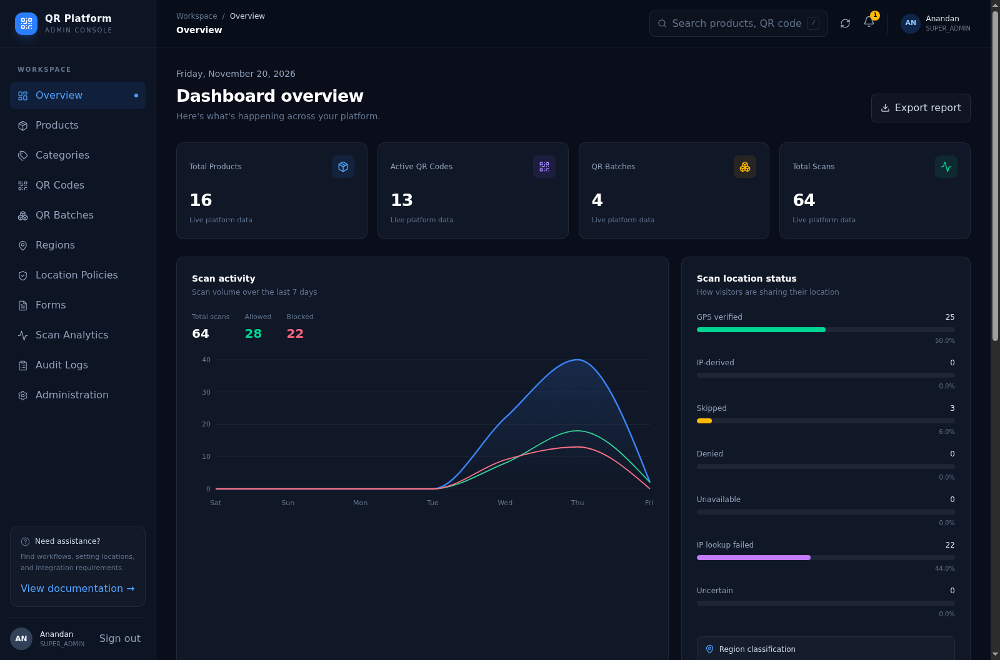
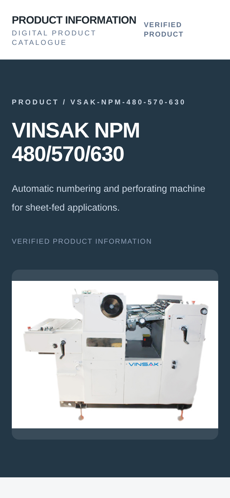

# QR Product Information Platform

A product catalogue and QR engagement platform. Administrators manage products and categories, create and allocate QR batches, define regions and location policies, publish product pages, review scan analytics, and inspect audit history. Customers open product pages by scanning allocated QR codes.

## Platform areas

- **Catalogue:** Products, hierarchical categories, draft and published product versions, and product media.
- **QR management:** QR code generation, batch allocation and reassignment, retirement, and PDF/PNG/SVG exports.
- **Regions and access:** Region hierarchy and boundaries, location policy assignments, and scan-time region checks.
- **Customer experience:** Mobile product pages, location permission flow, assigned forms, and product enquiries.
- **Operations:** Scan analytics, audit logs, administration, settings, health checks, database backup and restore scripts.

The following integrations are not configured in this release: IP geolocation, email or push delivery, external monitoring, and automated TLS certificate issuance. GPS requires HTTPS and customer permission. See [Operations](docs/OPERATIONS.md) for LAN and production constraints.

## Repository layout

| Path | Contents |
| --- | --- |
| `backend/` | FastAPI API, SQLAlchemy models, Alembic migrations, scripts, and tests |
| `frontend/` | React and Vite administrator console |
| `public-web/` | Next.js customer product and QR scan site |
| `database/` | Database setup and supporting SQL |
| `deployment/` | Nginx configuration and LAN certificate helper |
| `docs/` | User guide, operations, development workflow, screenshots, and publishing guidance |
| `compose*.yaml` | Local database, LAN preview, and production deployment definitions |

## Screenshots

Administrator dashboard:



Public website after scanning a QR code (phone view):



## Local development

Requirements: Docker with Compose, Python 3.12 or newer, Node.js 22, and npm.

On a new laptop, clone the repository and create a private local environment file:

```sh
git clone https://github.com/Vaishakh11000/qr-platform.git
cd qr-platform
cp .env.example .env
```

Edit `.env` and set a unique database password and an admin token secret generated with `openssl rand -hex 32`. Do not commit `.env`. The following steps start a local development database and the three applications; the administrator and public websites run only on this laptop unless you follow the LAN instructions below.

1. Start the local PostGIS database:

   ```sh
   docker compose up -d database
   ```

2. (Optional, for backend tests) Create the dedicated test database once. Tests create and drop application tables in this database, so do not point it at data you need to retain:

   ```sh
   docker exec qr-platform-db sh -lc 'createdb -U "$POSTGRES_USER" qr_platform_test'
   ```

3. Install backend dependencies, apply local development migrations, and create the first administrator:

   ```sh
   python3 -m venv .venv
   .venv/bin/pip install -r backend/requirements.txt
   PYTHONPATH=backend .venv/bin/alembic -c alembic.ini upgrade head
   PYTHONPATH=backend .venv/bin/python backend/scripts/create_first_admin.py
   ```

4. Run the API and administrator console in separate terminals:

   ```sh
   PYTHONPATH=backend .venv/bin/uvicorn app.main:app --reload --port 8000
   ```

   ```sh
   cd frontend
   npm ci
   npm run dev
   ```

5. Run the customer website in another terminal:

   ```sh
   cd public-web
   npm ci
   API_INTERNAL_URL=http://127.0.0.1:8000 npm run dev
   ```

Open the administrator console at `http://127.0.0.1:5173` and the public site at `http://127.0.0.1:3000`.

To load the included VINSAK sample catalogue on a fresh demo laptop, set `POSTGRES_DB=qr_platform_demo` in `.env` **before** starting the database, then run this after migrations and administrator setup:

```sh
DEBUG=false PYTHONPATH=backend .venv/bin/python backend/scripts/import_vinsak_seed.py \
  --apply --confirm-database qr_platform_demo
```

The imported products and versions are drafts and need review and publication in the admin console. The source notes that media licensing has not been confirmed; review `backend/data/vinsak_seed/README.md` before distributing catalogue media.

The API health endpoints are `/health` and `/ready`; the interactive API schema is at `/docs`. Local product media defaults to the ignored `storage/` directory.

For same-Wi-Fi phone access and secure-context GPS, use the LAN Compose and certificate instructions in [Operations](docs/OPERATIONS.md). Phones must trust the locally generated certificate authority. This preview is LAN-only and is not a public deployment.

## Verification

Run the backend suite only against the dedicated test database:

```sh
DEBUG=false .venv/bin/pytest backend/tests -q
```

Build the administrator and customer applications with:

```sh
cd frontend && npm run build
cd ../public-web && npm run build
```

The backend test fixtures create and drop test schema tables. Never set `TEST_POSTGRES_DB` to a production database or to a development database containing data you need.

## Deployment

`compose.production.yaml` is a deployment starting point requiring real DNS names, externally provisioned HTTPS certificates, unique secrets, backups, and an operational monitoring plan. It does not automatically apply migrations or issue certificates. Review [Operations](docs/OPERATIONS.md) before deploying.

## Further documentation

- [Detailed product and hierarchy user guide](docs/USER_GUIDE.md)
- [Operations and deployment](docs/OPERATIONS.md)
- [Development workflow](docs/DEVELOPMENT_WORKFLOW.md)
- [GitHub repository, downloads, and contribution workflow](docs/GITHUB_PUBLISHING.md)
